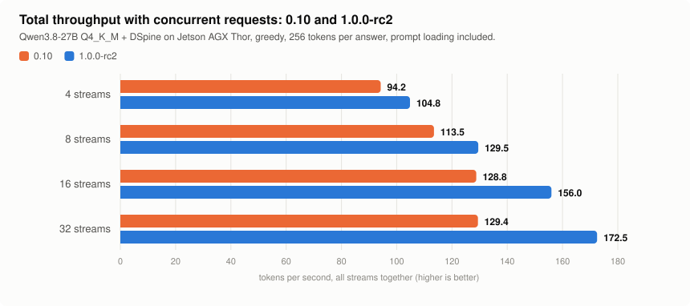

# Sixi-ASI Engine

Run Qwen3.8 on an NVIDIA Jetson AGX Thor. An inference engine with speculative decoding that leaves the answers
unchanged, parallel streams and an OpenAI-compatible API, as one download.

Measured with Qwen3.8-27B on an NVIDIA Jetson AGX Thor: **55 tok/s on one stream** over 60 prompts (plain
decoding: 12) and **150 tok/s in total with 16 to 32 requests at once**, each with a prompt of its own.
[How it was measured](docs/RESULTS.md).

<picture>
  <source media="(prefers-color-scheme: dark)" srcset="assets/streams-dark.svg">
  
</picture>

## Quick start

Download `sixi-asi-<version>-jetson-thor-aarch64.tar.gz` and its `.sha256` from the
[releases page](https://github.com/radeksixi/sixi-asi/releases), then:

```bash
sha256sum -c sixi-asi-*-jetson-thor-aarch64.tar.gz.sha256
tar xzf sixi-asi-*-jetson-thor-aarch64.tar.gz && cd sixi-asi-*-jetson-thor-aarch64
./sixi setup      # checks that this machine can run the release (nothing is built)
./sixi pull       # downloads Qwen3.8-27B, its drafter and image projector: 19.8 GB, resumable, checksummed
./sixi chat       # talk to it in the terminal
```

**You need** an NVIDIA Jetson AGX Thor with JetPack (the file `BUILD` in the archive names the L4T and CUDA versions
the release was built with), 19.8 GB of disk for the default model, and Python 3.8+ for the `sixi` command.
Other NVIDIA machines are not covered by this release.

## Use it

**One question**

```bash
./sixi run "What is 17 * 23?"
./sixi run --json "Three European capitals with their countries."      # one JSON object, nothing around it
./sixi run --schema person.schema.json "Describe Ada Lovelace."        # JSON that matches your schema
```

**A server with the OpenAI API**

```bash
./sixi serve --parallel 4          # http://127.0.0.1:8089, four requests decoded at once
```

```bash
curl -s localhost:8089/v1/chat/completions -d '{
  "messages": [{"role": "user", "content": "What is 17*23?"}],
  "max_tokens": 1024, "temperature": 0 }'
```

```python
from openai import OpenAI

client = OpenAI(base_url="http://127.0.0.1:8089/v1", api_key="none")
r = client.chat.completions.create(
    model="qwen3.8-27b",
    messages=[{"role": "user", "content": "Classify: 'The battery died after two days.'"}],
    response_format={"type": "json_schema", "json_schema": {"name": "label", "strict": True, "schema": {
        "type": "object",
        "properties": {"sentiment": {"type": "string", "enum": ["positive", "neutral", "negative"]}},
        "required": ["sentiment"], "additionalProperties": False}}},
)
print(r.choices[0].message.content)     # one JSON object that matches the schema
```

**In the background, like a local model service**

```bash
./sixi service install --parallel 4     # once; add --boot to start it with your session
./sixi service start                    # the API stays at http://127.0.0.1:8089/v1 until ./sixi service stop
```

Any OpenAI client works with `base_url="http://127.0.0.1:8089/v1"`; `./sixi chat` and `./sixi run` use the
running service instead of loading the model again. More in [docs/SERVICE.md](docs/SERVICE.md).

Reasoning arrives separately as `reasoning_content`; send `"enable_thinking": false` to skip it. Every request
field, the extra metrics in the response and the error codes are in [docs/API.md](docs/API.md).

## Commands

| Command | What it does |
|---|---|
| `./sixi setup` | checks the machine: hardware, the engine, its libraries, CUDA |
| `./sixi doctor` | machine, engine, models, server: what is there and what is missing |
| `./sixi models` | models known by name, their size, whether they are downloaded |
| `./sixi pull [-m NAME]` | downloads a model from Hugging Face into `~/.sixi/models` (or finds it in the Hugging Face cache) |
| `./sixi chat [-m NAME]` | interactive chat; starts a server when none is running and stops it afterwards |
| `./sixi run "prompt"` | one answer on standard output (`--json`, `--schema FILE`, `--no-think`, `-q`) |
| `./sixi serve [-m NAME]` | the server in the foreground (`--parallel N`, `--ctx N`, `--port P`, `--api-key KEY`) |
| `./sixi stop` | stops a server that `chat --keep` or `run --keep` left running |
| `./sixi service install` | the server as a background service (systemd user unit): `start`, `stop`, `restart`, `status`, `logs`, `remove`; `--boot` starts it with your session |
| `./sixi link` | puts the command on the PATH as `sixi-asi` |

`-m` also takes a GGUF file (`./sixi serve -m model.gguf --draft drafter.gguf`). Options after `--` go to
`bin/sixi-server` as they are; `bin/sixi-server --help` lists them. Files live under `~/.sixi`
(`SIXI_HOME`, `SIXI_MODELS_DIR`).

## Models

| Name | Weights | Download | Notes |
|---|---|---|---|
| `qwen3.8-27b` (default) | Qwen3.8-27B, Unsloth Dynamic v3.1 UD-Q4_K_XL, with the DSpine block drafter and the image projector | 19.8 GB | the measured configuration; parallel streams; images |
| `qwen3.8-flash-next` | Qwen3.8-Flash-Next (mixture of experts), UD-IQ4_XS, with its MTP draft head | 97.8 GB | one stream with drafts |

Both are Apache-2.0 and are downloaded from their authors' Hugging Face repositories (`configs/models.json` has the
repositories, sizes and checksums). No model is part of this archive.

## What the engine does

- **Speculative decoding that does not change the answer.** A small drafter proposes tokens and the model checks
  them, several per step. Greedy and sampled decoding both match plain decoding (tested on the distributions).
- **Parallel streams.** `--parallel N` (measured up to 32) answers N requests at once, and a long prompt being
  loaded does not stall the other conversations.
- **Structured answers.** `response_format` constrains the answer to one JSON object or to a JSON schema, also
  with drafts and parallel streams; a finished answer always parses and nothing follows its closing brace.
- **Images.** A message can carry pictures as `image_url` parts; the same loaded model answers them, next to text
  requests, and a picture stays in the conversation's memory.
- **Priority.** `"priority": "background"` keeps batch work out of the way of the turn a person is waiting for.
- **A talking agent.** `speech/sixi-speech` adds speech recognition and synthesis on CPU cores with the OpenAI
  audio API; [docs/VOICE-AGENT.md](docs/VOICE-AGENT.md) puts text, vision and speech together.
- **Samples and voting.** `n` samples of one prompt cost one prompt load; `"vote": true` returns the majority
  answer and stops the rest once it is decided.
- **Prompt cache.** A conversation continues from where it stopped, and a repeated prompt starts answering in
  1 ms; the cache can persist on disk. The end of a long system prompt is kept on its own, so every call of an
  agent's role starts from there, whichever conversation it belongs to. A client can mark other places worth
  keeping (`cache_control` on a content part: a document, a list of tools), and requests for the same prompt that
  arrive together load it once.
- **Checkable.** `"draft": false` answers one request without drafts, so anyone can compare the two answers on
  the running server (`scripts/exact_check.py`).
- **Short spoken answers in their language.** With the language in the request, a one-word answer ("nie", "ja",
  "non") is heard as that language and not as English.
- **Native Qwen3.8 chat template** (tools, reasoning effort, thinking on/off); reasoning budgets that end the
  reasoning instead of returning an empty answer; tool calls validated against their schema.

## Performance

NVIDIA Jetson AGX Thor, 1.0.0, measured on the files of this archive. The first row, the comparison with
llama.cpp, the rows on speech and pictures and the decoding speed of Flash-Next are from the release candidates,
whose decoding, speech and image code 1.0.0 leaves as it was. Full tables, quality gates and the comparison with
other engines are in [docs/RESULTS.md](docs/RESULTS.md); what changed in each version is in
[CHANGELOG.md](CHANGELOG.md).

| | |
|---|---|
| Qwen3.8-27B, one stream, default weights (UD-Q4_K_XL v3.1) | 43.4 tok/s, 3.6x plain decoding |
| The same over 60 prompts (math, code, everyday questions) | 55.0 tok/s (1.0.0-rc1: 51.4), 12 without drafts |
| Qwen3.8-27B, 2 / 4 / 8 / 32 requests at once, in total | 76 / 105 / 136 / 180 tok/s |
| The same with a prompt of its own for every request, 8 / 16 / 32 at once | 125 / 147 / 152 tok/s while the streams write, 116 / 133 / 134 over the whole run |
| llama.cpp v1.0.0 on the same machine and weights, built-in MTP drafts | 29.3 tok/s |
| An agent's role call with a 1,500-token system prompt: alone / five sessions at once | 1.3 s / 4.6 s (1.0.0-rc2: 3.4 / 15.7) |
| Four requests for one 4,100-token prompt sent together: all answered after | 8.0 s (1.0.0-rc3: 31.2 s) |
| A second question about a 3,000-token document marked with `cache_control`, after ten other prompts | 0.5 s (unmarked: 4 s) |
| 16 agents with an 18k-token prompt each: wait for the next turn | 3 s |
| JSON answers that parse, with a schema (120 cases) | 120 of 120 (108 without the constraint) |
| Answers that are the same with and without drafts (12 prompts, 256 tokens) | 9 of 12, 3.3x faster with drafts |
| A turn next to four background requests: first token | 0.18-0.26 s |
| A spoken question to the first audio of the answer (speech on the CPU) | 1.0-1.5 s |
| One-word spoken answers of Polish speakers heard right, with the language given / without | 201 / 80 of 300 |
| A picture: load / next turn about the same picture | 0.4-1.4 s / 0.1 s |
| Qwen3.8-Flash-Next, one stream | 53 tok/s on code, 45 in conversation |
| Qwen3.8-Flash-Next, loading a prompt of 18,500 tokens | 31 s, 600 tok/s (1.0.0-rc3: 56 s) |
| Context memory for 32 streams | 27.1 GB |
| Default weights against BF16 | KL divergence 0.008 |

## Check the numbers yourself

The measurement scripts are in `scripts/` (Python 3, standard library):

```bash
python3 scripts/ab_bench.py --engines sixi=http://127.0.0.1:8089 --max-tokens 256 --repeats 3 --out ab.json
python3 scripts/concurrency_bench.py --url http://127.0.0.1:8089 --streams 1,2,4
python3 scripts/multistream_check.py --url http://127.0.0.1:8089 --streams 4
python3 scripts/schema_eval.py --url http://127.0.0.1:8089 --compare-free
python3 scripts/intel_eval.py --engines sixi=http://127.0.0.1:8089 --effort low --max-tokens 8192
python3 scripts/speed_set.py --url http://127.0.0.1:8089          # one stream over 60 prompts
python3 scripts/streams_bench.py --url http://127.0.0.1:8089 --streams 8    # many requests, each its own prompt
python3 scripts/exact_check.py --url http://127.0.0.1:8089        # every prompt with and without drafts
python3 scripts/sampling_check.py --url http://127.0.0.1:8089     # the same prompt greedy, then sampled
python3 scripts/roles_bench.py --url http://127.0.0.1:8089 --sessions 5     # an agent's calls with long system prompts
python3 scripts/image_digits_check.py --url http://127.0.0.1:8089           # numbers in small pictures
python3 scripts/speech_short_check.py --url http://127.0.0.1:8088           # one-word spoken answers
```

`ab_bench.py` takes several engines (`--engines a=URL,b=URL --reference b`) and compares their answers with the
reference's, so any OpenAI-compatible server on the same machine can be put next to this one.

## Build from source

The engine's sources in this repository are those of 1.0.0 (Apache-2.0). They build the programs of the
archive (`sixi-server`, `sixi-cli`, `sixi-bench`), the library behind them and the tests:

```bash
cmake -B build -DCMAKE_BUILD_TYPE=Release -DSIXI_VERSION_SUFFIX=
cmake --build build -j
ctest --test-dir build --output-on-failure
```

You need CMake 3.24 or newer, a C++20 compiler, OpenSSL, and the CUDA toolkit for the engine's own kernels
(`-DSIXI_ENABLE_CUDA=OFF` builds without them). At run time the programs load the backend library, which is
published in binary form: take `lib/libllama.so` from the release archive and name it to the engine,

```bash
SIXI_LLAMA_LIB_PATH=/path/to/sixi-asi-1.0.0-jetson-thor-aarch64/lib/libllama.so \
  build/sixi-server --model model.gguf --draft-model drafter.gguf --port 8089
```

or copy the built programs into the archive's `bin/` and use `./sixi` as before. A server built this way writes
the same tokens at the same speed as the released one (60 of 60 prompts of `scripts/speed_set.py`).

`patches/` and `scripts/build_llamacpp.sh` are those of 0.11.0 and build the backend of that version. The changes
to llama.cpp v1.0.0 that 1.0 runs on are not published; they are in the archive's library.

## License

Free to use for any purpose and to pass on unchanged: see `LICENSE`. The archive includes llama.cpp, cpp-httplib
and nlohmann/json under their MIT licenses (`licenses/`). The engine's sources are in the repository
(Apache-2.0); the backend library (llama.cpp v1.0.0 with this engine's kernel and drafter changes) is released in
binary form, and the `sixi` and `sixi-speech` commands and the measurement scripts are plain Python.
