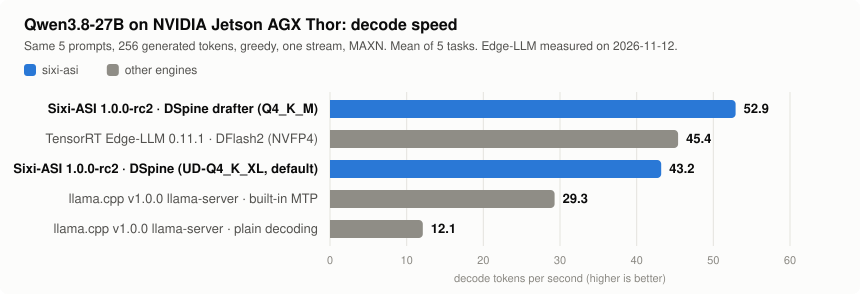

# Measured results

NVIDIA Jetson AGX Thor developer kit (122.9 GiB unified LPDDR5X, CUDA 13.2, MAXN). Qwen3.8-27B unless noted,
greedy, identical prompts for every engine, 256 generated tokens. The 1.0.0-rc2 rows were measured on 2026-11-15 and
the 1.0.0-rc1 rows on 2026-11-14, each on the files of its released archive, with nothing else on the GPU; rows of
other versions and engines carry their own date or version. The 1.0.0-rc3 rows were measured on 2026-11-17 on the
files of its archive; other work used the machine's CPU cores that day, so where rc3 is compared with rc2 the two
ran in turn.

<picture>
  <source media="(prefers-color-scheme: dark)" srcset="../assets/engines-dark.svg">
  
</picture>

**One stream** (`scripts/ab_bench.py`, median of 3 runs per task, mean of 5 tasks; the chart is drawn with the
1.0.0-rc2 figures, rc3 decodes at the same speed):

| Engine | Weights | Drafter | tok/s | vs plain decoding |
|---|---|---|---|---|
| **Sixi-ASI 1.0.0-rc3** | Q4_K_M | DSpine b16 | **53.2** | **4.4x** |
| Sixi-ASI 1.0.0-rc2 | Q4_K_M | DSpine b16 | 52.9 | 4.4x |
| Sixi-ASI 1.0.0-rc1 | Q4_K_M | DSpine b16 | 46.0 | 3.8x |
| TensorRT Edge-LLM 0.11.1 (2026-11-12) | NVFP4 | DFlash2 | 45.4 | 3.8x |
| **Sixi-ASI 1.0.0-rc3** | UD-Q4_K_XL v3.1 (default) | DSpine b16 | **43.4** | 3.6x |
| Sixi-ASI 1.0.0-rc2 | UD-Q4_K_XL v3.1 (default) | DSpine b16 | 43.2 | 3.6x |
| Sixi-ASI 1.0.0-rc1 | UD-Q4_K_XL v3.1 (default) | DSpine b16 | 44.1 | 3.7x |
| llama.cpp v1.0.0, llama-server | UD-Q4_K_XL v3.1 | built-in MTP, 4 drafts | 29.3 | 2.4x |
| llama.cpp v1.0.0, llama-server | UD-Q4_K_XL v3.1 | built-in MTP, 3 drafts, q4_0 KV cache | 27.3 | 2.3x |
| llama.cpp v1.0.0, llama-server, plain decoding | UD-Q4_K_XL v3.1 | - | 12.1 | 1.0x |

This test is five prompts, and it is decided by which text gets written: two builds whose answers differ in a few
tokens can differ by ten percent and more on it, because the drafter then agrees with the model for a different
share of the text. That is what moved Q4_K_M from 46.0 to 52.9 and the default weights from 44.1 to 43.2 between rc1
and rc2. The 60-prompt set below is the better measure, and so are longer runs: the 50-problem quality gate runs at
68.7 tok/s in rc2 against 66.7 in rc1, and three concurrent clients at 44.3 tok/s each against 41.2.

**One stream, a larger set** (60 prompts: 30 GSM8K problems, 20 HumanEval tasks, 10 everyday questions; greedy, 256
tokens, no reasoning phase; 13.5k generated tokens; two runs per version agree to 0.1 tok/s; the script ships with
the next release):

| Version | tok/s | Time per speculative step | Tokens accepted per step | Math / code / everyday prose, tok/s |
|---|---|---|---|---|
| **Sixi-ASI 1.0.0-rc3** | **54.7** | 114.5 ms | 6.27 | 59.5 / 105.7 / 25.7 |
| Sixi-ASI 1.0.0-rc2 | 54.7 | 114.6 ms | 6.27 | 59.4 / 105.8 / 25.7 |
| Sixi-ASI 1.0.0-rc1 | 51.4 | 120.3 ms | 6.19 | 56.6 / 100.6 / 24.0 |

This is the figure to compare versions by: rc2 is 6% faster than rc1 on one stream. How fast an answer is written
depends on the text: code is drafted several times better than everyday prose.

rc3 writes the same tokens as rc2 at the same speed. In turn on 2026-11-17: rc2 55.3, 55.2, 54.9; rc3 54.4,
54.4, 54.8, 55.1 (other work used the machine's CPU cores that day, and runs of one version spread by 0.5 to 1
tok/s). rc3 keeps eight prompt states where rc2 kept four, which is what makes the calls of an agent with
several roles 2.5 to 4 times faster (below) and costs a single stream nothing that can be measured: 54.7 tok/s
with 4 states, 55.1 with 8, 54.9 with 16 in the same hour.

**Concurrent requests** (`scripts/concurrency_bench.py`: every client answers the same five prompts, rotated, so
the streams carry equal work; total = all completion tokens / wall time, prompt loading included). 1-4 streams on
`--parallel 4`, 8-32 on `--parallel 32`:

| Concurrent streams | 1 | 2 | 4 | 8 | 16 | 32 |
|---|---|---|---|---|---|---|
| 1.0.0-rc3, UD-Q4_K_XL v3.1 (default) | 41.3 | 72.2 | 109.6 | 130.7 | 155.7 | **183.2** |
| 1.0.0-rc3, Q4_K_M | 50.3 | 77.2 | 108.8 | 121.5 | 145.1 | **179.3** |
| 1.0.0-rc2, UD-Q4_K_XL v3.1 (default) | 38.4 | 70.0 | 108.2 | 124.9 | 144.4 | **171.8** |
| 1.0.0-rc2, Q4_K_M | 45.8 | 73.7 | 104.8 | 129.5 | 156.0 | **172.5** |
| 1.0.0-rc1, UD-Q4_K_XL v3.1 | 38.2 | 63.9 | 97.7 | 117.1 | 151.7 | 171.0 |
| 0.11, UD-Q4_K_XL v3.1 | 37.7 | 63.7 | 90.3 | 118.7 | 150.6 | 170.5 |
| 0.10, Q4_K_M | 39.6 | 62.1 | 94.2 | 113.5 | 128.8 | 129.4 |

The default-weights figures for 8, 16 and 32 streams are means of three runs (rc3: 127.6-133.9, 149.0-163.9,
181.5-184.5; rc2: 122.2-127.5, 137.5-154.9, 170.2-174.0); the others are single runs, and a single run at 8-16
streams spreads by several percent. The totals include prompt loading, and that is where rc3 gains: the clients
send the same five prompts again and again, rc3 still has all of them (first token after 0.01 s with one stream
and 0.18 s with 32; rc2: 0.4 s and 0.9 s). A stream decodes as fast as in rc2.

With 32 streams each one decodes at 5.4-5.9 tok/s; with 16, about 10. Context memory for 32 streams: 27.1 GB
(25.3 GiB) for the model and 6.0 GB (5.6 GiB) for the drafter.

**Many agents with long prompts** (`scripts/agents_bench.py`: 16 agents, each with its own 18k-token document and
two follow-up questions, `--parallel 16 --ctx 24576`, default weights): a follow-up reaches its first token after
3.0 s (median), 3.2 s at worst, while other agents are still loading their documents (rc1: 2.8 and 2.9 s). All three
turns of all agents: 567 s (rc1: 553 s; rc3: 567 s, follow-up 3.0 s median and 3.5 s at worst).

**An agent with several roles** (`scripts/roles_bench.py`: every turn of a session is three calls one after
another, each role with its own system prompt of 1,500 tokens, the conversation so far and a short JSON answer;
1,700 tokens in, 20 out; `--parallel 8`). Such calls are almost all prompt, so what they cost is how much of the
prompt the server still has:

| Sessions at once | 1 | 5 | 8 |
|---|---|---|---|
| 1.0.0-rc3: seconds a call / calls a second in all / prompt tokens not read again | 1.3 / 0.59 / 86% | 4.5 / 1.17 / 86% | 6.6 / 1.24 / 86% |
| 1.0.0-rc2 | 3.4 / 0.29 / 0% | 15.7 / 0.36 / 7% | 26.8 / 0.34 / 5% |

With six roles and five sessions rc3 takes 4.4 s a call (85% not read again); with ten callers on the eight
slots, 7.4 s (a caller that finds no free slot is answered 429 and tries again).

**Quality gate** (`scripts/intel_eval.py`, reasoning effort low, thinking on, greedy, up to 8192 tokens):

| Run | GSM8K | HumanEval | Tool calls | Needle (6k) |
|---|---|---|---|---|
| Sixi-ASI 1.0.0-rc3, DSpine, UD-Q4_K_XL v3.1 | 28/30 | 19/20 | pass | pass |
| same, as three concurrent clients on `--parallel 4` | 28/30 each | 19/20 each | pass | pass |
| Sixi-ASI 1.0.0-rc2, DSpine, UD-Q4_K_XL v3.1 | 28/30 | 19/20 | pass | pass |
| same, as three concurrent clients on `--parallel 4` | 28/30 each | 19/20 each | pass | pass |
| Sixi-ASI 1.0.0-rc1, DSpine, UD-Q4_K_XL v3.1 | 28/30 | 19/20 | pass | pass |
| Sixi-ASI 0.11, DSpine, UD-Q4_K_XL v3.1 | 28/30 | 19/20 | pass | pass |
| Sixi-ASI 0.10, DSpine, Q4_K_M, wider sample | 76/80 | 58/60 | | |
| TensorRT Edge-LLM, DFlash2, NVFP4 (0.9.0 run) | 28/30 | 19/20 | pass | pass |

Concurrent answers are not byte-identical to a solo run of the same prompt: they diverge after a few hundred
characters, and the scores above are the same either way. Repeated solo runs are identical
(`scripts/multistream_check.py`).

**Structured answers** (`scripts/schema_eval.py`: the same prompt, which contains the schema, with and without
`response_format`):

| Set | With the constraint | Without |
|---|---|---|
| 10 agent-style schemas x 3 prompts in five languages, one stream | 30/30 valid | 24/30 |
| 30 general schemas x 3 prompts, one stream | 88/90; two answers reached `max_tokens` inside the document (`finish_reason: length`) | 79/90 |
| agent schemas, 8 streams | 30/30 | |
| general schemas, 8 streams | 90/90 | |
| general schemas, sampled (temperature above 0) | 90/90 | |
| general schemas with reasoning on | 30/30 | |

The constraint costs about 2% of the speed on answers the model would have written correctly anyway (2-5% over a
whole set). The two unfinished answers are the model's own: a counting loop that the unconstrained answer has too,
and a string it closed with the wrong quote character, which is legal text inside a string. In rc1 the same set
gave 90/90 and 89/90 (8 streams): which prompts go wrong moves with small numerical changes. rc3 gives rc2's
figures in every row.

**Sampling after a greedy answer** (`scripts/sampling_check.py`: five questions with one certain answer; the same
prompt at temperature 0 and then sampled with six seeds, and the other way round): rc3 45 of 45 answers right, rc2
20 of 45. Up to rc2 a sampled request for a prompt that had just been answered at temperature 0 began with a stray
character.

**Images** (the model's own projector; six prompts with one or two pictures, greedy, next to llama.cpp v1.0.0's
server with the same projector): the prompts come to the same number of tokens in all six cases, the answers say
the same; one of the six is identical to the character, the others part ways at a word choice. A small
picture (about 300 rows) loads in 0.6 s, a large one capped with `--image-max-tokens 512` in 1.2 s; in the next turn
of the same conversation the picture costs nothing (first token after 0.11 s). Requests with and without pictures
run side by side.

Reading numbers in a small picture (`scripts/image_digits_check.py`: fifteen 480 x 480 pictures of a six-digit
number): 5 of 15 read at the picture's own 225 rows (0.4 s to load), 14 of 15 with `--image-min-tokens 1024
--image-max-tokens 1024` (1.4 s). llama.cpp v1.0.0's server reads 5 and 14 of the same pictures at the same
settings: a small picture needs more rows before its text can be read.

**A turn a person waits for, next to background work** (`scripts/voice_latency.py`, `--parallel 8
--reserve-interactive 1`; first token of a short streamed turn):

| Meanwhile | Median | Worst |
|---|---|---|
| nothing | 0.14 s | 0.15 s |
| 4 background requests generating | 0.18 s | 0.25 s |
| 4 background requests loading 4k-token prompts | 0.26 s | 0.61 s |
| 2 generating and 2 loading | 0.26 s | 0.54 s |
| one request loading a 4k-token prompt without `"priority": "background"` | 1.8 s | 2.2 s |

**A whole spoken turn** (`scripts/voice_turn_demo.py`: the question as audio, speech recognition and synthesis by
`sixi-speech` on the CPU, the answer spoken sentence by sentence):

| Question | Understood after | First token | First audio of the answer, after the question ended | Whole turn |
|---|---|---|---|---|
| English | 0.17 s | 0.25 s | 1.5 s | 1.8 s for 7.1 s of speech |
| German | 0.10 s | 0.20 s | 1.5 s | 1.7 s for 6.4 s of speech |
| Italian | 0.14 s | 0.20 s | 1.0 s | 1.6 s for 5.3 s of speech |
| English, about a picture | 0.11 s | 1.2 s | 2.1 s | 2.1 s for 2.7 s of speech |

Short answers (1.0.0-rc3, `scripts/speech_short_check.py`): one-word clips spoken by many people (Multilingual
Spoken Words Corpus, CC-BY 4.0; words cut from sentences, so harder than an answer said alone). Right / heard as
another word / nothing heard:

| | Polish, 300 clips of 8 words | German, 280 of 7 | French, 317 of 8 | Italian, 161 of 6 |
|---|---|---|---|---|
| without the language in the request | 80 / 153 / 67 | 41 / 171 / 68 | 76 / 172 / 69 | 38 / 98 / 25 |
| with `language` | 201 / 21 / 78 | 126 / 18 / 136 | 146 / 35 / 136 | 76 / 33 / 52 |

A Polish "nie" was heard as "Yeah." in 37 of 80 clips and right in 2; with `language=pl` it is right in 24 of 40.
0.2 to 0.35 s a clip (Whisper turbo with the language on the Polish clips: 132 right, 168 wrong, 2 s a clip).
Short answers said by the service's own voices, with `language`: German 15 of 15, French 12 of 12, Italian 12 of
12, Polish 30 of 30 with the voice `pl-female` and 19 of 30 with `pl` (without: 9, 10, 7, and 36 of 60).

Speech recognition (Parakeet TDT 0.6b v3): a 4-6 s utterance in 0.2-0.35 s. Speech synthesis (Piper voices): 2-3 s
of speech in 0.3-0.4 s. Both on CPU cores; the language model's first token is the same with the speech service
idle or busy.

**Qwen3.8-Flash-Next** (UD-IQ4_XS with its MTP head, one stream, benchmark program with a fixed draft length,
median of three repeats):

| | Plain decoding | With drafts |
|---|---|---|
| Code prompt | 28.5 | 53.2 |
| Conversation prompt | 28.2 | 44.6 |

**Hard reasoning** (0.11 run: 40 AIME problems, 3 samples each, temperature 0.6, reasoning effort low, 10240 tokens,
4 streams):

| Weights | One sample | Majority of 3 | Any of 3 | KL divergence to BF16 |
|---|---|---|---|---|
| UD-Q4_K_XL v3.1 (default) | 70.0% | 82.5% | 82.5% | 0.0077 |
| Q4_K_M | 70.0% | 80.0% | 85.0% | 0.0248 |

**Long context** (0.10 run, `--ctx 65536`, DSpine, Q4_K_M):

| Document | First question | Prompt loading | Next question | Decode |
|---|---|---|---|---|
| 4.8k tokens | 6.9 s | 698 tok/s | 0.31 s | 30-45 tok/s |
| 15k | 21 s | 711 tok/s | 0.39 s | 29-48 tok/s |
| 34k | 52 s | 653 tok/s | 0.48 s | 24-36 tok/s |
| 59k | 104 s | 571 tok/s | 0.58 s | 22-26 tok/s |

64k tokens of context take about 4.5 GB per stream.
